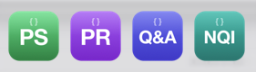

# workspace-icon-generator

Gives a VS Code `.code-workspace` file its own Dock icon on macOS: a rounded square with a vertical gradient, a faint `{ }` glyph, and a bold two-letter label.

The icon is stored the way macOS expects custom file icons: an `icns` resource in the file's resource fork, plus the custom-icon flag in Finder info. Once both are set, the Dock shows the workspace's icon instead of the generic VS Code document icon.



## Quick start

```sh
uvx --from git+https://github.com/willpike-suki/workspace-icon-generator workspace-icon-generator path/to/my-project.code-workspace --abbr MP
```

## Requirements

- macOS. The script uses `iconutil` and `xattr`, which ship with macOS. No Xcode tools are needed.
- `rsvg-convert`: `brew install librsvg`
- [uv](https://docs.astral.sh/uv/): `brew install uv`

## Options

| Option | Default | Meaning |
| --- | --- | --- |
| `TARGET` | required | The `.code-workspace` file to give an icon to |
| `--abbr` | required | The label, usually two initials. Longer labels are shrunk to fit. |
| `--top` | `#E4589F` | Gradient colour at the top |
| `--bottom` | `#8F1B66` | Gradient colour at the bottom |
| `--work` | a new temp dir | Scratch directory for the SVG, PNGs, and `.icns` |

The script prints the path of a 1024 px preview PNG, then checks that the icon resource and the custom-icon flag are both in place. It exits with an error if either is missing.

